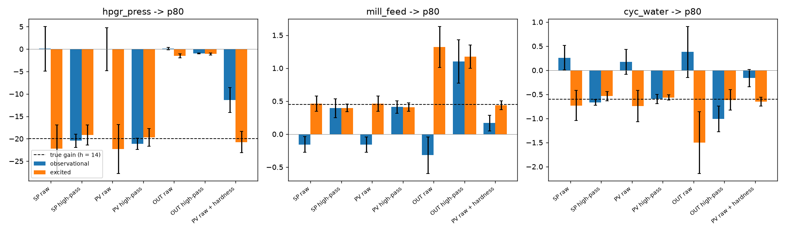

# Crosscut Process Suite

Process performance suite for mineral processing. **Status: early development. Module 1 (loop monitoring and PID tuning) is usable as an advisory tool and is validated on simulated loops; only parts of the triage were checked on public real-loop data, and nothing has been tested on a plant.**

The goal is a toolkit that a process engineer can configure without programming:

- loop monitoring and PID tuning,
- soft sensors and anomaly detection,
- model predictive control and fuzzy / expert rules,
- ML-based recommendation of operating ranges and economic optimization,
- native OPC UA connectivity.

Every module is optional; a plant picks what it needs.

## Module 1: loop monitoring and PID tuning

What a process engineer can do today, on simulator data or on a CSV / SQL export (details, evidence and limits per
item: [docs/HANDOFF.md](docs/HANDOFF.md)):

- **Loop overview and worklist** (web UI `frontend/`, API `api/`, logic `loops/`): health in %, findings (manual,
  saturated, flatline, oscillating, poor performance, valve hints), key numbers, trends, and per loop a **next action
  and a priority rank**. The ranking is a rule, not a validated score. Conclusions that need per-loop knowledge
  (output range, dead time, oscillation limits) are reported as "not assessed" instead of being guessed.
- **Oscillation without configuration**: a parameter-free ACF regularity test (Thornhill et al. 2003 with our noise
  band). It misses records with fewer than about eight cycles and can raise false alarms on fast noise in long records
  (up to 9 % in simulation); the finding says so.
- **Valve**: travel, reversals, output resolution and sizing hints; a **weak stiction hint** from passive data (never a
  diagnosis) and a **guided valve stroke test** that gives deadband and resolution from a deliberate test
  ([docs/VALVE_STROKE_TEST.md](docs/VALVE_STROKE_TEST.md); validated on simulation only).
- **Tuning report**: FOPDT model from a step test, SIMC and AMIGO PI/PID settings, conversion to vendor forms
  (Siemens checked against public manuals, ABB partly), withheld when the model fits badly. **Tuning from history**
  uses natural setpoint steps; on real data it rarely applies and then says "do a bump test".
- **Benefit estimate** with its assumptions next to the number.
- **Fuzzy Studio** (advisory rule bases with what-if and replay) and **live OPC UA demos**:
  [docs/LIVE_DEMO.md](docs/LIVE_DEMO.md).

Limits you should know: all data in this repository is synthetic and all validation is simulated, apart from
exploratory runs on two public loop datasets (SACAC, ISDB; not redistributed). Stiction cannot be diagnosed from
passive data, time-constant and delay estimates are poor at full noise, the sluggish-loop (idle index) idea was tried
and dropped, and the OPC UA server was tested with a Python client only. Tuning and advice are advisory: nothing in
this repository writes to a DCS.

**Level (integrating) loops, experimental.** A level loop is modelled as a pure integrator with dead time (IPDT)
from an OUT step test. The settings use the upper bound of the dead-time interval, not the point estimate, and the
screen labels them experimental. In simulation, 0 of 276 accepted fits gave an unsafe controller in round 2 (3 of 270
in round 1, before the upper bound was used). The dead-time interval covered the true dead time in 86.6 % of cases
(target 90 %, missed). Not validated on any real loop ([exp28](experiments/exp28_integrating_step_test/README.md)).

## Module 2: advisory supervisor

Status: proposed design ([ADR 010](docs/adr/010-advisory-supervisor.md)), tested on simulated data only.

- **What it is**: advice on the mill feed setpoint (increase, decrease or hold) from a fuzzy rule base. Advice is gated by
  module 1 loop state (manual, saturated and flatline block; oscillating only warns), explained by its dominant rules,
  and written to an append-only, hash-chained log. An operator records a decision (accepted, rejected or deferred) with
  a reason code.
- **No writes to a plant**: the package never imports OPC UA or connector code and writes only under `_advisory/` and
  `_supervisor/` in the data root. Mode can only be `off` or `advisory`; a closed-loop mode needs a future ADR.
- **Where**: `supervisor/` (package `crosscut_supervisor`), `api/src/crosscut_api/supervisor_routes.py`, the Advisor view
  in `frontend/` (`src/advisory.ts`, `src/components/AckForm.tsx`), and the schemas `schemas/supervisor.schema.json`
  and `schemas/advisory-record.schema.json`.
- **Try it**: in the Advisor view, load the bundled example `supervisor/examples/mill_feed_advisor.json`, then run a
  replay on a simulated dataset. Advice shows its gate state; during injected manual or flatline windows no magnitude
  is given.
- **Claim limits**:
  - Evidence is simulation only. In exp27 (20 test seeds, one run, frozen criteria) the fuzzy v2 rule base kept P80 on
    target more often than a crisp threshold rule (median 0.65 vs 0.49) without more mill-power excursions. A scripted
    operator that uses the ore hardness estimate reached 0.79, so the advisor does not replace that information.
    The crisp baseline was not tuned, and the rule bases were shaped on this simulator
    ([results](experiments/exp27_supervisor_benefit/README.md)).
  - Acceptance of advice (0.8) and the 300 s delay are assumptions of the simulated operator, not measurements.
  - No plant data has been used.
  - `who` on an acknowledgement is free text and is not authenticated.

## Module 3: anomaly detection

Status: advisory, simulated data only.

- **What it is**: PCA with Hotelling T2 and SPE limits, lagged columns and a stuck-sensor rule. It flags drift, freeze
  and out-of-model events and names the contributing tags. Bad-quality and missing rows are skipped, never imputed.
- **No writes to a plant**: `anomaly/` never imports write code; a CI guard test checks this.
- **Where**: `anomaly/`, `api/src/crosscut_api/anomaly_routes.py`, the Anomalies view (`frontend/src/components/AnomalyPage.tsx`),
  `schemas/anomaly.schema.json`, example `anomaly/examples/mill_circuit_pca.json`.
- **Try it**: in the Anomalies view press "Load example", then scan a simulated dataset. Read the T2 and SPE charts against
  their limits and the contribution bars of the flagged events.
- **Claim limits** (exp29, test seeds run once, [results](experiments/exp29_anomaly_detection/README.md)):
  - Simulation only. Drift detected in 19/20 fault records; frozen sensor in 19/20, by the stuck rule.
  - False alarms 1.79 per 24 h on quiet records (target 1.0, missed), mostly from operator setpoint moves; the view says so.
  - Spikes (0.05), bad-quality rows and dropouts are not detected; the last two are skipped by design.
  - Not validated on real plant data.

## Module 4: soft sensor

Status: advisory, simulated data only.

- **What it is**: PLS on lagged process tags that estimates a quality variable between sparse, delayed lab results. Each row
  has a validity flag (`ok`, `missing_input`, `out_of_range`, `extrapolation`); a bias tracker compares the estimate with lab results.
- **No writes to a plant**: `softsensor/` writes to no system; mode is `off` or `advisory` only, and a CI guard test checks this.
- **Where**: `softsensor/`, `api/src/crosscut_api/softsensor_routes.py`, the Soft sensor view (`frontend/src/components/SoftSensorPage.tsx`),
  `schemas/softsensor.schema.json`, example `softsensor/examples/mill_circuit_pls.json`.
- **Try it**: in the Soft sensor view press "Load example", pick a simulated dataset with lab results, set the train end and
  run the fit. Compare the estimate with the lab points and read the validity flags.
- **Claim limits** (exp30, test seeds run once, [results](experiments/exp30_soft_sensor/README.md)):
  - Simulation only; the hidden quality variable was generated for the test, so it is not a plant result.
  - Beats the last lab value in 31/34 normal records (RMSE 0.857 vs 1.384).
  - Validity flags work: 0.988 of out-of-range rows are flagged. Do not use the estimate where a flag is shown.
  - The drift flag is not reliable (5/33 drift records vs 5/34 normal); the view marks it as not validated.
  - Not validated on a real plant.

## Write path (design only)

[ADR 011](docs/adr/011-write-path.md) is a proposed design for one write gateway, the only component that could ever write
to a control system. It is not accepted, and nothing in this repository can write to a plant. The `gateway/` package holds
12 strict expected-failure scenarios that state the required safety behaviour before any such code exists.

## Foundations (stage 0)

- Simulators with known ground truth: Wood-Berry distillation column and a grinding circuit (HPGR, mill, cyclone)
  with an operator that confounds setpoints with ore hardness (`sim/`).
- Reproducible Parquet datasets, named scenarios, `python -m crosscut_sim.run` (`sim/`).
- OPC UA test server (client writes, heartbeat watchdog) and a collector (`opcua/`).
- Artifact manifests with integrity checks (`artifacts/`), JSON Schema data contracts (`schemas/`).
- C++20 core smoke test with a pybind11 parity test, CI on Linux and Windows (`core/`).
- [Experiment 0](experiments/exp00_sp_vs_mv/README.md): which signals recover true gains from confounded
  closed-loop data. Short answer: raw setpoint and actuator signals fail, high-passed ones recover the gain.



## Quick start

```bash
python -m pip install -r requirements-dev.txt
python -m pytest
python -m crosscut_sim.run --plant mill_circuit --scenario observational --duration 6h --out data/
python -m crosscut_opcua.server --plant wood_berry --scenario nominal --port 4840 --speed 10
python experiments/exp00_sp_vs_mv/exp00.py --seeds 5 --hours 48
```

## Repository layout

| Path | Content |
|---|---|
| `schemas/` | JSON Schemas for the data contracts (single source of truth) |
| `sim/` | Plant simulators with known ground truth (`crosscut-sim`) |
| `opcua/` | OPC UA test server and data collector |
| `artifacts/` | Artifact manifests (read, write, verify) |
| `core/` | C++20 runtime core with Python bindings |
| `loops/` | Loop monitoring, KPIs and worklist, valve tests, identification, tuning, benefit |
| `api/` | FastAPI backend of the web UI |
| `frontend/` | Web UI (React, TypeScript) |
| `connectors/` | CSV, SQL and OPC UA import |
| `fuzzy/` | Fuzzy rule bases and inference |
| `ident/` | Model identification and ML tooling (planned) |
| `experiments/` | Reproducible experiments |
| `docs/` | Documentation, architecture decision records, provenance log |

## Development

```bash
python -m pip install -r requirements-dev.txt
python -m pytest
```

Code, comments, commit messages and documentation are written in English.

## Provenance

All methods are implemented from public literature; see [docs/PROVENANCE.md](docs/PROVENANCE.md).
All data in this repository is synthetic.

## License

GNU Affero General Public License v3.0 (AGPL-3.0-only), see [LICENSE](LICENSE). A commercial licence is available
for users who cannot work under the AGPL; see [LICENSING.md](LICENSING.md). Your own configuration, rules and
models are data and stay yours ([ADR 009](docs/adr/009-configuration-versus-code.md)).
