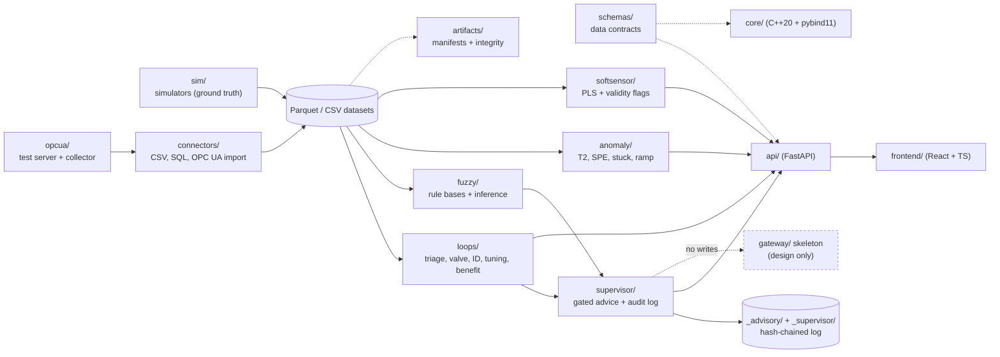

# Crosscut Process Suite — Project Design

Detailed design record for the owner and for future assistant sessions. It states what is being built, why,
and what is explicitly not being built. Every claim below is drawn from the repository documents cited; where the
sources are silent, they say **not decided**.

Companion documents: `README.md` (status and per-module limits), `docs/HANDOFF.md` (state of work, real-data notes),
`docs/NEXT_MODULE_OPTIONS.md` (why module 2 came next), `docs/TESTING_STRATEGY.md` (L0–L7 ladder), and the ADRs in
`docs/adr/` (decision records). The ADRs override this document where they conflict.

**Provenance of this document (2026-10-24).** The owner's original planning documents (Polish: strategy, plan, stage specs;
`OpenExpert/docs/` on the owner's machine) are not available in this repository or to the assistant. This design is reconstructed
from the public repository (README, ADRs, testing strategy, implementation log, handoff). The owner should compare it with the
original plan and list what was lost or changed; differences go into section 10.

---

## 1. Vision and users

**Who.** The primary user is any process engineer who configures the toolkit **without programming**, with their own
tags, laboratory results, analysers and loops. Crosscut is a generic framework, not a set of ready-made cases. Plant 1
(a grinding/flotation circuit) is only the validation domain: plant data validates features and never defines
features, defaults or titles. Every module-4 feature works on any tag. A secondary user is the plant controls engineer who
must supervise anything that could touch a controller.

**What problem.** Process loops are often in manual, saturated, flatlining or oscillating, and tuning is done by
rule of thumb. Lab assays arrive late and sparse, so quality is not known between lab results. Operator decisions on
setpoints (for example a feed rate) are not logged or gated by loop health. The suite aims to turn historian and OPC UA
data into findings, tuning reports, advice and quality estimates, with the evidence and the limits written next to
each number.

**Scope aimed at.** Loop monitoring and PID tuning, soft sensors and anomaly detection, MPC and fuzzy/expert rules,
ML-based operating-range recommendation and economic optimisation, and native OPC UA connectivity. Every module is
optional; a plant picks what it needs (`README.md`).

**What it is NOT (today and by design):**

- **No writes to a plant.** Nothing in the repository can write to a control system. Modules 2–4 never import OPC UA
  or connector write code; CI guard tests enforce this (`README.md`, ADR 010). The write path is a proposed design
  only (`gateway/`, ADR 011).
- **Advisory first.** Tuning and advice are advisory; nothing writes to a DCS (`README.md`).
- **No user code.** Rules, models and parameters are declarative schema-validated data; the engine never executes
  user-supplied code in its process (ADR 009).
- **No plant validation.** All data in the repository is synthetic. The only non-synthetic runs are exploratory on
  two public loop datasets (SACAC, ISDB, not redistributed) and the owner's confidential plant data, which stays
  outside the repository (`docs/PROVENANCE.md`, `docs/HANDOFF.md`).

---

## 2. Principles

1. **Climb a ladder of realism.** Each level proves something specific and leaves something unproven; the unproven
   part is written down with a plan to retire it (`docs/TESTING_STRATEGY.md`, `docs/ASSUMPTIONS.md`). Simulator
   success is not a plant claim.
2. **Frozen protocols, misses recorded, never retuned.** Every experiment freezes and commits its protocol before any
   run; test seeds run once; amendments are allowed only before the first development seed and are written down.
   Misses ship visibly and thresholds are not moved (for example the anomaly false-alarm figure and the soft-sensor
   drift flag are shown as not validated) — `docs/HANDOFF.md`, decisions 2 and working rules.
3. **Configuration is data** (ADR 009, proposed). User-supplied configuration, rules and models are declarative files
   validated against `schemas/`. Extension that needs user code runs as a separate program and talks through the
   documented interfaces. The proposed AGPL section 7 additional permission is not yet a licence term (awaiting legal
   review).
4. **A GUI slice for every feature.** Each shipping module has a web view and an example: Loops, Fuzzy, Advisor,
   Anomalies, Soft sensor, Import (plus the Steps view) — `docs/HANDOFF.md`, `README.md` try-it instructions.
5. **Real data stays outside the repository.** The owner's plant data is confidential, never committed, and never
   sent to external services; reports may quote numbers, not bulk data. Third-party data follows
   `docs/PROVENANCE.md` (`docs/HANDOFF.md`, decision 5).
6. **Honest claim limits.** Findings say "not assessed" rather than guessing; the strongest firing strength is called
   *activation*, never *confidence*; the strongest evidence claims are "in our simulator, with our operator model"
   (`README.md`, ADR 010).

---

## 3. Architecture

### Packages and their responsibility

| Package / path | Responsibility | Status |
|---|---|---|
| `schemas/` | JSON Schemas for all data contracts — single source of truth | shipping |
| `sim/` | Wood-Berry distillation column and grinding circuit simulators with known ground truth; reproducible Parquet datasets, named scenarios (`python -m crosscut_sim.run`) | shipping |
| `opcua/` | OPC UA test server (client writes, heartbeat watchdog) and data collector | tested with a Python client only |
| `artifacts/` | Artifact manifests with integrity checks (read, write, verify) | shipping |
| `core/` | C++20 runtime core with pybind11 bindings and a parity test (C++ against a Python reference) | smoke test only |
| `connectors/` | CSV, SQL and OPC UA import | read-only |
| `loops/` | Loop monitoring, KPIs and worklist, valve tests, identification, tuning, benefit | shipping (simulation evidence) |
| `fuzzy/` | Fuzzy rule bases and inference (rule matrix, versions, backtest) | shipping |
| `supervisor/` | Advisory supervisor (`crosscut_supervisor`): gated advice, hash-chained audit log | shipping (advisory only) |
| `anomaly/` | PCA / Hotelling T2 / SPE, lagged columns, stuck-sensor rule, ramp warning | shipping (advisory only) |
| `softsensor/` | PLS on lagged tags, validity flags, bias tracker, long-format loader | shipping (advisory only) |
| `gateway/` | Write-path skeleton: 12 strict expected-failure scenarios and static no-write guards | design only; no write code |
| `api/` | FastAPI backend of the web UI (routes per module) | shipping |
| `frontend/` | React + TypeScript web UI (Trends, Loops, Fuzzy, Advisor, Anomalies, Soft sensor, Import, Steps) | shipping; e2e suite green |
| `ident/` | Model identification and ML tooling | planned |
| `experiments/` | Reproducible experiments (exp00, exp18–31) | ongoing |

### Language split (ADR 001, accepted)

- The **control runtime** (cycle, MPC, write gateway, writing connectors) is C++20 with CMake (MSVC on Windows,
  GCC/Clang on Linux): deterministic, long-running, single binary, hard to tamper with.
- **Offline tooling** is Python: simulation, identification, ML training, experiments.
- Both sides share code through pybind11 bindings so simulations and backtests run the same controller code as
  production. Every core class needs a parity test against its Python reference.
- **Until the first write to a real DCS, read-only products may stay in Python.**

### Data contracts

`schemas/` is the single source of truth. Named schemas: `supervisor.schema.json`, `advisory-record.schema.json`,
`anomaly.schema.json`, `softsensor.schema.json`, `fuzzy.schema.json`, and a planned `write-policy` schema (ADR 011).
The artifact format is the contract between C++ and Python (`artifacts/` manifests with integrity checks).

### Data flow

The dashed `gateway/` link is deliberate: it is the *only* component that could ever write, and it does not exist as
write code today. The supervisor, anomaly and soft-sensor packages have CI guard tests that fail if they import a
write capability.

---

## 4. Modules

### 4.1 Module 1 — Loop monitoring and PID tuning

**Purpose.** Give the process engineer a triage of loops: which are healthy, which need attention, and what to do next.

**What ships** (`loops/`, `api/`, `frontend/`):

- Loop overview and worklist: health in %, findings (manual, saturated, flatline, oscillating, poor performance,
  valve hints), key numbers, trends, per-loop **next action and priority rank**. The rank is a rule, not a validated
  score. Conclusions needing per-loop knowledge are reported as "not assessed".
- Parameter-free ACF oscillation test (Thornhill et al. 2003 with a noise band).
- Valve checks: travel, reversals, output resolution, sizing hints, a **weak stiction hint** from passive data (never
  a diagnosis), and a **guided valve stroke test** giving deadband and resolution.
- Tuning report: FOPDT from a step test; SIMC and AMIGO PI/PID; conversion to vendor forms (Siemens checked against
  public manuals, ABB partly); withheld when the model fits badly. Tuning from history (natural setpoint steps) says
  "do a bump test" when it does not apply.
- Benefit estimate with its assumptions next to the number.
- Integrating (level) loops, **experimental**: IPDT from an OUT step test; settings use the upper bound of the
  dead-time interval and carry an experimental label.
- Step test intake (CLI `step_test_cli` and Import view), the Steps view (OUT steps in manual, SP steps in auto,
  FOPDT/IPDT with standard errors, consistency check), `tools/driver_response.py` for driver/output pairs.

**Evidence.** exp18–26 and exp28 (simulation). For integrating loops, exp28 round 2: 0 of 276 accepted fits gave an
unsafe controller; dead-time interval covered the true dead time in 86.6 % of cases (target 90 %, missed). Exploratory
runs on SACAC and ISDB.

**Claim limits.** Simulation only for methods; public data exploratory. The ACF test misses records under about eight
cycles and raises up to 9 % false alarms on fast noise in long records (the finding says so). Stiction cannot be
diagnosed from passive data. Time-constant and delay estimates are poor at full noise. The worklist needs a blind
review. Integrating-loop tuning is not validated on any real loop.

**Missing for real use.** The blind worklist review (Kendall tau ≥ 0.5, ≥ 80 % next-action agreement; owner task).
One real valve stroke test. Controller tunings from the DCS (a real level record was correctly refused by the wizard
because there was no clean open-loop step). The ABB TI/TD unit from one real `PidCC` export.

### 4.2 Module 2 — Advisory supervisor

**Purpose.** Advise on a process-level setpoint (first validation case: a feed rate) with advice gated by module 1 loop state,
explained by its dominant rules, logged, and acknowledged by an operator.

**What ships** (`supervisor/`, `api/src/crosscut_api/supervisor_routes.py`, Advisor view, `supervisor.schema.json`,
`advisory-record.schema.json`, example `supervisor/examples/mill_feed_advisor.json`): fuzzy rule base producing
increase/decrease/hold; gates from module 1 (manual, saturated, flatline block; oscillating warns); append-only,
hash-chained audit log; acknowledgement with reason code. Mode is `off` or `advisory` only.

**Evidence.** ADR 010 proposed; exp27 round 1 met E1–E5. In exp27 (20 test seeds, one run, frozen criteria) the fuzzy
v2 rule base kept P80 on target more often than a crisp threshold rule (median 0.65 vs 0.49) without more mill-power
excursions; a scripted operator using the ore hardness estimate reached 0.79.

**Claim limits.** Simulation only. The crisp baseline was not tuned; the rule bases were shaped on this simulator, so
the advisor does not replace the ore hardness information. Acceptance (0.8) and the 300 s delay are operator-model
assumptions, not measurements. `who` on an acknowledgement is free text and not authenticated.

**Missing for real use.** Real operator behaviour data (not possible yet). ADR 010 review by the owner. An
operator-authority model is a prerequisite for any `confirm` mode (ADR 011).

### 4.3 Module 3 — Anomaly detection

**Purpose.** Flag drift, freeze and out-of-model events in process data and name the contributing tags.

**What ships** (`anomaly/`, `anomaly_routes.py`, Anomalies view, `anomaly.schema.json`, example
`anomaly/examples/mill_circuit_pca.json`): PCA with Hotelling T2 and SPE limits, lagged columns, stuck-sensor rule;
bad-quality and missing rows skipped, never imputed; possible-ramp warning (`anomaly/ramp_detect.py`,
`unreliable_tags` in responses) for straight stretches ≥ 6 h, with counters skipped.

**Evidence.** exp29 round 3 met B1–B6: drift 16/20 fault records, freeze 18/20 (stuck rule), 0.36 false alarms per
24 h on quiet records (target 1.0, met) with alpha 0.999, min_consecutive 15.

**Claim limits.** Simulation only. Spikes (0.05) and bad-quality rows and dropouts are not detected (the last two are
skipped by design). Limits fitted on a short training record are weak (use weeks of quiet data). The ramp warning is
exploratory: precision against real archive gaps is unknown. An anomaly smoke test on real normal operation gave
about 0.3 events/24 h with 3 weeks of training (1 week: 94 % flagged); a tag interpolated over an archive gap fooled
the detector — not a false-alarm estimate.

**Missing for real use.** At least 2 weeks of real quiet operation plus labelled events (owner task). A list of real
archive gaps to measure ramp-warning precision.

### 4.4 Module 4 — Soft sensor

**Purpose.** Estimate a quality variable between sparse, delayed lab results from lagged process tags.

**What ships** (`softsensor/`, `softsensor_routes.py`, Soft sensor view, `softsensor.schema.json`, example
`softsensor/examples/mill_circuit_pls.json`, plus `softsensor/long_format.py`, `tools/lab_extract.py` and
`tools/analyzer_vs_lab.py`): PLS on lagged tags; per-row validity flags (`ok`, `missing_input`, `out_of_range`,
`extrapolation`); bias tracker. The plant import masks an exact −9999 sentinel as missing.

**Evidence.** exp30: beats the last lab value in 31/34 normal records (RMSE 0.857 vs 1.384); 0.988 of out-of-range
rows flagged. exp31 (real data, frozen protocol, not blind): the Courier analyser halves the error of the last lab
value on Cu and Mo concentrate; EWMA lab bias correction hurt Cu; the calibrated line is worse than the raw Courier for
the tails.

**Claim limits.** Simulation only for exp30; the hidden quality variable was generated for the test. The drift flag is
not reliable (5/33 drift vs 5/34 normal) and the view marks it not validated. exp31 is not blind (data seen in
exploration); a true test needs the next delivery. On plant 1 a process-only PLS soft sensor of lab grades was **not
achievable** from four weeks (negative blocked-CV R²), while an online analyser as a configured reference input worked;
this is a result of that validation run, not a product requirement. The engine takes any tag as reference input, with a
validity flag and an optional lab bias correction (off by default, checked on the user's data).

**Missing for real use.** Confirmation of the lab stamp meaning (end of 6 h composite plus up to about 1 h) and the
Courier −9999 meaning from the LIMS owner; the analyser latency is assumed 0 and still unmeasured. The next data
delivery for a blind test; months of data.

### 4.5 Fuzzy Studio

**Purpose.** Author, version and replay advisory rule bases ("configuration is data", ADR 009).

**What ships.** `fuzzy/` (rule matrix, inference, versions, backtest) with `fuzzy.schema.json`; the Fuzzy view in
`frontend/` with what-if and replay; example rule bases used by the supervisor.

**Evidence.** exp27 exercised the v2 rule base in closed-loop simulation. The earlier backtest (exp09) left 43 % of
operator moves facing a silent rule base (ADR 010 context) — the gating design addresses this.

**Claim limits.** Rule behaviour is evidenced on the mill-circuit simulator with the simulated operator only.

**Missing for real use.** ADR 009 lawyer review and adoption of the section 7 clause; owner use of the editor on a
real rule base.

---

## 5. Not yet built

| Item | What exists | Prerequisite |
|---|---|---|
| **MPC** | plan only; C++ core smoke test; simulator | write-path safety work (ADR 011 accepted, soft-PLC suite V5); MPC identification of quality variables is "not possible yet (missing data)" |
| **ML operating-range recommendation (DML)** | planned in `docs/PROVENANCE.md` | real historian data; confounding in real data must be checkable where the generator's truth is known; the optimisation objective (economic value per PV unit and limits) is **not decided** |
| **Economic optimisation** | none | the objective (owner task, not decided) and operating limits |
| **Native OPC UA runtime connectivity** | test server and collector; read-only client; "tested with a Python client only" | UaExpert check (owner task); write path for any runtime write; ADR 011 |
| **Write path** | `gateway/` skeleton, 12 strict-xfail scenarios, static no-write guards; ADR 011 proposed | ADR 011 accepted; owner decisions on authority model (who may enable modes, who changes policy, operator authority, watchdog periods, hold-off times); management-of-change / functional-safety review; 12 scenarios pass on a soft PLC |

The C++ control runtime (ADR 001) is part of MPC and the write path; today it is only a smoke test with a Python
parity test.

---

## 6. Validation ladder L0–L7 (`docs/TESTING_STRATEGY.md`)

| Level | Proves | Module 1 | Modules 2–4 | Foundations |
|---|---|---|---|---|
| L0 unit/contract tests, CI Linux+Windows | code and contracts behave as specified | reached | reached | reached |
| L1 simulators with ground truth | methods recover known effects | reached | reached | reached |
| L2 fault injection, messy-data corpus | robustness to bad data | stage 1 (list defined, V1/V2 backlog) | stage 1 | fault injection exists in sim |
| L3 public real datasets | behaviour on real measurements | exploratory on SACAC, ISDB (used once or twice before losing independence) | not used | — |
| L4 physical lab testbed | real noise, actuator limits | not started (V4) | not started | not started |
| L5 virtual DCS / soft PLC | write-path semantics | n/a | n/a | not started (V5); must pass before any write |
| L6 customer-run read-only validation | real formats and quality | in progress (owner PI extract explored) | not started (need 2 weeks quiet, lab CSV) | L6 kit planned (V6) |
| L7 pilot under agreement | everything, for one site | not started (V7) | not started | not started |

The current formal position is *L2 for modules 1–4 (simulation and injected faults), with real data used only in L6-style
exploration and never committed to the repository.*

---

## 7. Roadmap

### Phase A — Foundations (done)

**Goal.** Simulators with known ground truth, data contracts, artifacts, test server, C++ smoke test. **Exit criteria.**
`pytest` green, CI on Linux and Windows, exp00 answers which signals recover true gains. **Status.** Done.

### Phase B — Module 1 (done on simulation, needs real evidence)

**Goal.** Loop monitoring, valve checks, tuning reports for a process engineer. **Exit criteria.** Views ship,
e2e green, misses recorded. **Status.** Done on simulation; experimental integrating loops. Open: blind worklist
review, real valve stroke test, DCS controller tunings.

### Phase C — Modules 2–4, advisory on simulation (done)

**Goal.** Supervisor, anomaly detection and soft sensor as read-only tools with a GUI slice and guard tests.
**Exit criteria.** Each experiment meets its frozen criteria or records the misses; claims stated honestly. **Status.**
Done; misses shipped visibly (exp30 drift flag, exp31 protocol-worded miss R3).

### Phase D — Real-data phase (in progress)

**Goal.** Move evidence from synthetic to real, using the confidential flotation-line PI extract (kept outside the
repository), the lab and Courier analyser package, and a proper exp31 blind test on the next delivery. **Exit
criteria.** exp31 reproduced blind; lab-stamp and −9999 meanings confirmed; analyser latency measured; a real
level-loop model when the DCS tunings and an open-loop step test arrive. **Status.** In progress. The generic exp31
finding: the Courier analyser halves the error of the last lab value on Cu and Mo concentrate, lab bias correction
hurts Cu, and the test is not blind.

### Phase E — Pilot readiness

**Goal.** Everything the owner must supply or decide before a first site can be approached. **Exit criteria.** One
real valve stroke test recorded; blind worklist review passed; ADRs 008/010/011 reviewed; UaExpert check done; native
pl/es review done (committed `42d00c4`); ESLint `max-params` cleared; the 23 deliberately deferred
`max-lines-per-function` warnings decided by the owner. **Status.** Open items listed above; pl/es review done.

### Phase F — Write path and MPC

**Goal.** A single Write Gateway that can, in `confirm` and later `supervised` modes, write only to cascaded or
external-setpoint PID setpoints under a declarative write policy, with read-back verification, watchdog, operator
priority, kill switch, and a hash-chained audit log. **Exit criteria.** ADR 011 accepted; owner decides the authority
model; the 12 gateway scenarios pass on a soft PLC (V5); a supervised site test done by the owner; then MPC. **Status.**
Blocked on ADR 011 acceptance and V5. Nothing may write before this.

---

## 8. Risks and open decisions for the owner

| # | Risk / decision | Why it matters | Owner to bring back |
|---|---|---|---|
| 1 | ADR 008 (AGPL) review | decides what a customer may run and publish | accept or changes |
| 2 | ADR 010 (advisory supervisor) review | defines what is recommended and how advice is acknowledged | accept or changes |
| 3 | ADR 011 (write path) review + open points | only place a write to a live system would be allowed | authority model, vendor conventions, watchdog periods, hold-off times, regulatory/MoC approval, whether closed loop is wanted |
| 4 | Real level step test (flotation cell) | the integrating-loop model needs a real step response | CSV + mode/units/sample period, cell and valve |
| 5 | Real valve stroke test on a flow loop | the simulated stroke model is unverified | record + filled results table |
| 6 | Blind worklist review (~20 loops) | the ranking has no outside check | reviewer's ranking and next actions |
| 7 | Anomaly real data (≥ 2 weeks quiet + labelled events) | detector limits are only meaningful against real quiet data | CSV + event list |
| 8 | Soft-sensor real data (lab timestamps, delay, tags) | the quality variable is only real with lab timing | lab CSV + delay + tag list |
| 9 | Lab-stamp and Courier sentinel meaning; analyser latency | exp31 alignment rests on assumptions | confirmation from the LIMS/analyser owner |
| 10 | UaExpert check; ABB `PidCC` TI/TD export | OPC UA demo and ABB unit conversion are assumed today | notes / export |
| 11 | Optimisation objective (economic value per PV unit, limits) | no optimisation module without it | value per unit, operating limits |
| 12 | UI authentication; whether first customer needs MPC | deployment design, security scope, ranking of Phase F | yes/no and reasons |
| 13 | Ramp-warning precision against real archive gaps; PI gap list | the warning is exploratory | list of tags/weeks with PI archive gaps |
| 14 | Level sensor range and clip, valve behaviour in manual, windup questions | needed to judge real level tuning | answers in writing |
| 15 | Next A4/A5 delivery kept untouched for a blind exp31 test | exp31 was not blind | new weeks of data, not opened by the assistant |

Items that are **not decided** in the sources and therefore cannot be treated as settled: whether the first customer
needs MPC; whether UI authentication is required; the authority model; the optimisation objective; the vendor
conventions at the relevant sites.

---

## 9. Document map

| Document | Use |
|---|---|
| `README.md` | status, per-module claim limits, quick start, repository layout |
| `docs/HANDOFF.md` | state of the modules, experiment rounds, real-data notes, working rules |
| `docs/IMPLEMENTATION_LOG.md` | per-step implementation detail |
| `docs/NEXT_MODULE_OPTIONS.md` | how a candidate module is judged; why module 2 came next |
| `docs/TESTING_STRATEGY.md` | L0–L7 ladder, fault-injection catalogue, backlog V1–V8 |
| `docs/ASSUMPTIONS.md` | unproven assumptions and retirement plans (keep current) |
| `docs/PROVENANCE.md` | public sources and third-party datasets (licences) |
| `docs/OWNER_TASKS.md` | what only the owner can do; what to bring back |
| `docs/VALVE_STROKE_TEST.md` | guided valve stroke test procedure |
| `docs/LIVE_DEMO.md` | live OPC UA demos and UaExpert procedure |
| `docs/design/plant-import.md` | whole PI file import |
| `docs/design/step-analyzer.md` | Steps view design |
| `docs/design/fuzzy-studio.md` | Fuzzy Studio editor design |
| `docs/adr/001` | C++ runtime, Python offline tooling (accepted) |
| `docs/adr/006` | provenance / third-party material rules |
| `docs/adr/008` | AGPL-3.0-only licensing |
| `docs/adr/009` | configuration is data (proposed) |
| `docs/adr/010` | advisory supervisor cannot write (proposed) |
| `docs/adr/011` | write path design only (proposed) |
| `LICENSE`, `LICENSING.md`, `CONTRIBUTING.md`, `CLAUDE.md` | licence, commercial terms, CLA, session rules |
| `experiments/exp00_sp_vs_mv/` | which signals recover true gains |
| `experiments/exp18..26/` | module 1 evidence |
| `experiments/exp27_supervisor_benefit/` | supervisor benefit |
| `experiments/exp28_integrating_step_test/` | integrating-loop tuning |
| `experiments/exp29_anomaly_detection/` | anomaly evidence |
| `experiments/exp30_soft_sensor/` | soft-sensor evidence |
| `experiments/exp31_courier_softsensor/` | Courier vs lab (real data, not blind) |
---

## 10. Goal versus state (the one-page view) and differences from the original plan

The README states five goals. Where each stands on 2026-10-24:

| Goal | State | Evidence level | Next real step |
|---|---|---|---|
| Loop monitoring and PID tuning | usable advisory tool, GUI, level loops experimental | simulation + exploratory public/real data | blind worklist review, valve stroke test, DCS tunings |
| Soft sensors and anomaly detection | modules 3 and 4 shipped, advisory | simulation; real data explored (Courier input works, process-only PLS does not) | blind exp31 on a new delivery; real quiet weeks for anomaly limits |
| MPC and fuzzy / expert rules | fuzzy + advisory supervisor shipped; MPC not started | simulation | MPC waits for the write path |
| ML operating-range recommendation and economic optimisation | not started | none | objective and real historian data |
| Native OPC UA connectivity | test server, collector, read import | Python client only | UaExpert check; write path (ADR 011) |

**Differences from the original plan: to be filled by the owner after comparing with `OpenExpert/docs/`.** Known drift worth
checking: the licence changed from Apache-2.0 to AGPL-3.0-only (ADR 008); module order was decided by evidence availability
(`NEXT_MODULE_OPTIONS.md`), not by the original stage order; the C++ runtime has not grown beyond a smoke test because nothing writes yet.
