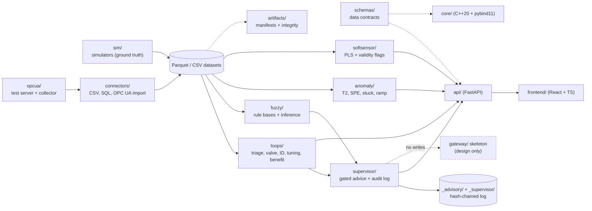

# Crosscut Process Suite — Projekt (dokument projektowy)

*Wersja polska dokumentu `docs/PROJECT_DESIGN.md`. W razie rozbieżności obowiązuje wersja angielska.*

Szczegółowy zapis projektowy dla właściciela i dla przyszłych sesji asystenta. Określa, co jest budowane, dlaczego
i co świadomie nie jest budowane. Każde twierdzenie poniżej pochodzi z przywołanych dokumentów repozytorium; tam, gdzie
źródła milczą, zaznaczono **niezdecydowane**.

Dokumenty towarzyszące: `README.md` (status i ograniczenia poszczególnych modułów), `docs/HANDOFF.md` (stan prac, uwagi o danych rzeczywistych),
`docs/NEXT_MODULE_OPTIONS.md` (dlaczego moduł 2 był następny), `docs/TESTING_STRATEGY.md` (drabinka L0–L7) oraz ADR-y w
`docs/adr/` (zapisy decyzji). W razie sprzeczności ADR-y mają pierwszeństwo przed tym dokumentem.

**Pochodzenie tego dokumentu (2026-10-24).** Nie istnieje pisemny plan pierwotny. Projekt był kształtowany w rozmowie i nigdy nie powstał żaden
polski plik strategii, planu ani specyfikacji etapów; `docs/design/` zawiera plany na poziomie funkcji pisane w trakcie
prac, a nie nadrzędny plan główny. Ten zapis projektowy jest zatem zrekonstruowany z publicznego repozytorium (README, ADR-y, strategia
testów, dziennik implementacji, handoff). Właściciel jest nadal proszony o przeczytanie go w konfrontacji z własną pamięcią planu
i o wypisanie wszystkiego, czego brakuje lub co się zmieniło; różnice trafiają do sekcji 10.

---

## 1. Wizja i użytkownicy

**Kto.** Głównym użytkownikiem jest każdy inżynier procesu, który konfiguruje zestaw narzędzi **bez programowania**, z własnymi
tagami, wynikami laboratoryjnymi, analizatorami i pętlami. Crosscut jest ogólnym szkieletem, a nie zestawem gotowych przypadków. Zakład 1
(obieg mielenia/flotacji) jest wyłącznie domeną walidacji: dane zakładowe walidują funkcje i nigdy nie definiują
funkcji, wartości domyślnych ani tytułów. Każda funkcja modułu 4 działa na dowolnym tagu. Drugorzędnym użytkownikiem jest zakładowy inżynier
sterowania, który musi nadzorować wszystko, co mogłoby ingerować w sterownik.

**Jaki problem.** Pętle procesowe są często w trybie ręcznym, w nasyceniu, spłaszczone lub oscylują, a strojenie odbywa się
metodą prób i błędów. Wyniki laboratoryjne przychodzą z opóźnieniem i rzadko, więc jakość nie jest znana między wynikami laboratoryjnymi. Decyzje operatora dotyczące
wartości zadanych (na przykład prędkości podawania) nie są rejestrowane ani warunkowane stanem pętli. Zestaw ma na celu przekształcenie danych z historyzatora i OPC UA
w ustalenia, raporty strojenia, zalecenia i szacunki jakości, z dowodami i ograniczeniami zapisanymi obok
każdej liczby.

**Zakres docelowy.** Monitorowanie pętli i strojenie PID, miękkie czujniki i detekcja anomalii, MPC oraz reguły rozmyte/eksperckie,
rekomendacja zakresu pracy oparta na ML i optymalizacja ekonomiczna oraz natywna łączność OPC UA. Każdy moduł jest
opcjonalny; zakład wybiera to, czego potrzebuje (`README.md`).

**Czym to NIE jest (dzisiaj i z założenia):**

- **Żadnych zapisów do zakładu.** Nic w repozytorium nie może zapisywać do systemu sterowania. Moduły 2–4 nigdy nie importują OPC UA
  ani kodu zapisującego konektora; testy strażnicze w CI tego pilnują (`README.md`, ADR 010). Ścieżka zapisu jest tylko proponowanym projektem
  (`gateway/`, ADR 011).
- **Najpierw doradczość.** Strojenie i zalecenia mają charakter doradczy; nic nie zapisuje do DCS (`README.md`).
- **Brak kodu użytkownika.** Reguły, modele i parametry to deklaratywne dane walidowane schematami; silnik nigdy nie wykonuje
  kodu dostarczonego przez użytkownika w swoim procesie (ADR 009).
- **Brak walidacji zakładowej.** Wszystkie dane w repozytorium są syntetyczne. Jedyne uruchomienia nie-syntetyczne to eksploracyjne na
  dwóch publicznych zbiorach pętli (SACAC, ISDB, nie są redystrybuowane) oraz poufne dane zakładowe właściciela, które pozostają
  poza repozytorium (`docs/PROVENANCE.md`, `docs/HANDOFF.md`).

---

## 2. Zasady

1. **Wspinaczka po drabinie realizmu.** Każdy poziom dowodzi czegoś konkretnego i pozostawia coś nieudowodnionego; nieudowodniona
   część jest zapisana wraz z planem jej wycofania (`docs/TESTING_STRATEGY.md`, `docs/ASSUMPTIONS.md`). Sukces symulatora
   nie jest twierdzeniem o zakładzie.
2. **Zamrożone protokoły, odnotowane porażki, nigdy nie przestrajane.** Każdy eksperyment zamraża i zatwierdza swój protokół przed jakimkolwiek
   uruchomieniem; nasiona testowe uruchamiane są jednokrotnie; poprawki są dozwolone tylko przed pierwszym nasionem rozwojowym i są zapisywane.
   Porażki są widoczne w dostarczanym produkcie, a progi nie są przesuwane (na przykład wskaźnik fałszywych alarmów w detekcji anomalii i flaga dryfu miękkiego czujnika są
   pokazane jako niezwalidowane) — `docs/HANDOFF.md`, decyzje 2 i zasady pracy.
3. **Konfiguracja to dane** (ADR 009, proponowany). Konfiguracja, reguły i modele dostarczone przez użytkownika to pliki deklaratywne
   walidowane wobec `schemas/`. Rozszerzenie wymagające kodu użytkownika działa jako osobny program i komunikuje się przez
   udokumentowane interfejsy. Proponowane dodatkowe pozwolenie z sekcji 7 AGPL nie jest jeszcze warunkiem licencji (oczekuje na przegląd
   prawny).
4. **Wycinek GUI dla każdej funkcji.** Każdy dostarczany moduł ma widok webowy i przykład: Loops, Fuzzy, Advisor,
   Anomalies, Soft sensor, Import (plus widok Steps) — `docs/HANDOFF.md`, instrukcje wypróbowania w `README.md`.
5. **Ogólne narzędzie, walidowane na danych zakładowych.** Każda funkcja działa na dowolnym tagu, laboratorium, analizatorze i pętli skonfigurowanych przez
   użytkownika; żadna nazwa tagu, jednostka, kod brakującej wartości, okno ani próg jednego zakładu nie może być stałą w `*/src`.
   Dane zakładowe walidują i nigdy nie definiują funkcji, wartości domyślnych ani tytułów.
6. **Dane rzeczywiste pozostają poza repozytorium.** Dane zakładowe właściciela są poufne, nigdy nie są zatwierdzane i nigdy nie są
   wysyłane do usług zewnętrznych; raporty mogą cytować liczby, a nie dane masowe. Dane firm trzecich podlegają
   `docs/PROVENANCE.md` (`docs/HANDOFF.md`, decyzja 5).
7. **Uczciwe granice twierdzeń.** Ustalenia mówią „nie oceniono" zamiast zgadywać; najsilniejsza siła odpalenia reguły nazywana jest
   *aktywacją*, nigdy *pewnością*; najsilniejsze twierdzenia dowodowe brzmią „w naszym symulatorze, z naszym modelem operatora"
   (`README.md`, ADR 010).

---

## 3. Architektura

### Pakiety i ich odpowiedzialność

| Pakiet / ścieżka | Odpowiedzialność | Status |
|---|---|---|
| `schemas/` | Schematy JSON dla wszystkich kontraktów danych — jedyne źródło prawdy | dostarczany |
| `sim/` | Symulatory kolumny destylacyjnej Wooda-Berry'ego i obiegu mielenia ze znaną prawdą wzorcową; odtwarzalne zbiory Parquet, nazwane scenariusze (`python -m crosscut_sim.run`) | dostarczany |
| `opcua/` | Serwer testowy OPC UA (zapisy klienta, watchdog heartbeat) i kolektor danych | testowany tylko klientem Python |
| `artifacts/` | Manifesty artefaktów z kontrolą integralności (odczyt, zapis, weryfikacja) | dostarczany |
| `core/` | Rdzeń wykonawczy C++20 z powiązaniami pybind11 i testem parytetu (C++ wobec referencji Python) | tylko test dymny |
| `connectors/` | Import CSV, SQL i OPC UA | tylko odczyt |
| `loops/` | Monitorowanie pętli, KPI i lista robocza, testy zaworów, identyfikacja, strojenie, korzyści | dostarczany (dowody z symulacji) |
| `fuzzy/` | Bazy reguł rozmytych i wnioskowanie (macierz reguł, wersje, backtest) | dostarczany |
| `supervisor/` | Nadzorca doradczy (`crosscut_supervisor`): zalecenia bramkowane, dziennik audytu łańcuchowany hashem | dostarczany (wyłącznie doradczy) |
| `anomaly/` | PCA / Hotelling T2 / SPE, kolumny z opóźnieniami, reguła zablokowanego czujnika, ostrzeżenie o rampie | dostarczany (wyłącznie doradczy) |
| `softsensor/` | PLS na tagach z opóźnieniami, flagi ważności, śledzenie obciążenia, loader formatu długiego | dostarczany (wyłącznie doradczy) |
| `gateway/` | Szkielet ścieżki zapisu: 12 ścisłych scenariuszy oczekiwanej porażki i statyczne strażniki braku zapisu | tylko projekt; brak kodu zapisu |
| `api/` | Backend FastAPI interfejsu webowego (trasy per moduł) | dostarczany |
| `frontend/` | Interfejs webowy React + TypeScript (Trends, Loops, Fuzzy, Advisor, Anomalies, Soft sensor, Import, Steps) | dostarczany; zestaw e2e zielony |
| `ident/` | Identyfikacja modeli i narzędzia ML | planowany |
| `experiments/` | Odtwarzalne eksperymenty (exp00, exp18–31) | w toku |

### Podział języków (ADR 001, zaakceptowany)

- **Środowisko wykonawcze sterowania** (cykl, MPC, brama zapisu, konektory zapisujące) to C++20 z CMake (MSVC na Windows,
  GCC/Clang na Linux): deterministyczne, długo działające, jeden plik binarny, trudne do manipulacji.
- **Narzędzia offline** to Python: symulacja, identyfikacja, trening ML, eksperymenty.
- Obie strony współdzielą kod przez powiązania pybind11, dzięki czemu symulacje i backtesty uruchamiają ten sam kod sterownika co
  produkcja. Każda klasa rdzenia wymaga testu parytetu wobec swojej referencji Python.
- **Do pierwszego zapisu do rzeczywistego DCS produkty tylko do odczytu mogą pozostać w Pythonie.**

### Kontrakty danych

`schemas/` jest jedynym źródłem prawdy. Nazwane schematy: `supervisor.schema.json`, `advisory-record.schema.json`,
`anomaly.schema.json`, `softsensor.schema.json`, `fuzzy.schema.json` oraz planowany schemat `write-policy` (ADR 011).
Format artefaktu jest kontraktem między C++ a Python (manifesty `artifacts/` z kontrolą integralności).

### Przepływ danych

Przerywane połączenie do `gateway/` jest zamierzone: to *jedyny* komponent, który kiedykolwiek mógłby zapisywać, i dzisiaj nie istnieje jako
kod zapisu. Pakiety supervisor, anomaly i soft-sensor mają testy strażnicze w CI, które kończą się niepowodzeniem, jeśli zaimportują
zdolność zapisu.

---

## 4. Moduły

### 4.1 Moduł 1 — Monitorowanie pętli i strojenie PID

**Cel.** Dać inżynierowi procesu triage pętli: które są zdrowe, które wymagają uwagi i co zrobić dalej.

**Co jest dostarczane** (`loops/`, `api/`, `frontend/`):

- Przegląd pętli i lista robocza: kondycja w %, ustalenia (ręczny, nasycony, spłaszczony, oscylacja, słaba wydajność,
  wskazówki dotyczące zaworu), kluczowe liczby, trendy, dla każdej pętli **następna akcja i ranga priorytetu**. Ranga jest regułą, a nie zwalidowanym
  wynikiem. Wnioski wymagające wiedzy o konkretnej pętli są raportowane jako „nie oceniono".
- Test oscylacji ACF bez parametrów (Thornhill i in. 2003 z pasmem szumu).
- Kontrole zaworów: skok, liczba zmian kierunku, rozdzielczość wyjścia, wskazówki doboru, **słaba wskazówka stick-slip** z danych pasywnych (nigdy
  nie diagnoza) oraz **prowadzony test skoku zaworu** dający martwe pole i rozdzielczość.
- Raport strojenia: FOPDT z testu skokowego; SIMC i AMIGO PI/PID; konwersja na formy producentów (Siemens sprawdzony wobec
  publicznych instrukcji, ABB częściowo); wstrzymywany, gdy model dopasowuje się źle. Strojenie z historii (naturalne skoki wartości zadanej) mówi
  „wykonaj test skokowy", gdy nie ma zastosowania.
- Szacunek korzyści z założeniami zapisanymi obok liczby.
- Pętle całkujące (poziom), **eksperymentalne**: IPDT z testu skoku OUT; nastawy korzystają z górnej granicy
  przedziału martwego czasu i noszą etykietę eksperymentalną.
- Wprowadzanie testu skokowego (CLI `step_test_cli` i widok Import), widok Steps (skoki OUT w trybie ręcznym, skoki SP w trybie auto,
  FOPDT/IPDT z błędami standardowymi, kontrola spójności), `tools/driver_response.py` dla par driver/wyjście.

**Dowody.** exp18–26 i exp28 (symulacja). Dla pętli całkujących, runda 2 exp28: 0 z 276 zaakceptowanych dopasowań dało
niebezpieczny regulator; przedział martwego czasu pokrył prawdziwy martwy czas w 86,6 % przypadków (cel 90 %, porażka). Uruchomienia eksploracyjne
na SACAC i ISDB.

**Granice twierdzeń.** Wyłącznie symulacja dla metod; dane publiczne eksploracyjne. Test ACF pomija rekordy poniżej około ośmiu
cykli i generuje do 9 % fałszywych alarmów na szybkim szumie w długich rekordach (ustalenie tak mówi). Stick-slip nie da się
zdiagnozować z danych pasywnych. Szacunki stałej czasowej i opóźnienia są słabe przy pełnym szumie. Lista robocza wymaga ślepej
recenzji. Strojenie pętli całkujących nie jest zwalidowane na żadnej rzeczywistej pętli.

**Brakuje do użycia rzeczywistego.** Ślepa recenzja listy roboczej (Kendall tau ≥ 0,5, zgodność następnej akcji ≥ 80 %; zadanie właściciela).
Jeden rzeczywisty test skoku zaworu. Nastawy regulatorów z DCS (rzeczywisty rekord poziomu został poprawnie odrzucony przez kreatora,
ponieważ nie było czystego skoku w otwartej pętli). Jednostka TI/TD ABB z jednego rzeczywistego eksportu `PidCC`.

### 4.2 Moduł 2 — Nadzorca doradczy

**Cel.** Doradzać w sprawie wartości zadanej na poziomie procesu (pierwszy przypadek walidacji: prędkość podawania) z zaleceniami bramkowanymi stanem pętli z modułu 1,
wyjaśnianymi przez reguły dominujące, rejestrowanymi i potwierdzanymi przez operatora.

**Co jest dostarczane** (`supervisor/`, `api/src/crosscut_api/supervisor_routes.py`, widok Advisor, `supervisor.schema.json`,
`advisory-record.schema.json`, przykład `supervisor/examples/mill_feed_advisor.json`): baza reguł rozmytych dająca
zwiększenie/zmniejszenie/zatrzymanie; bramki z modułu 1 (tryb ręczny, nasycenie, spłaszczenie blokują; oscylacja ostrzega); dziennik audytu tylko do dopisywania,
łańcuchowany hashem; potwierdzenie z kodem przyczyny. Tryb to wyłącznie `off` lub `advisory`.

**Dowody.** ADR 010 proponowany; runda 1 exp27 spełniła E1–E5. W exp27 (20 nasion testowych, jedno uruchomienie, zamrożone kryteria) baza reguł fuzzy
v2 utrzymywała P80 na celu częściej niż ostra reguła progowa (mediana 0,65 vs 0,49) bez większej liczby przekroczeń mocy młyna;
operator skryptowy korzystający z oszacowania twardości rudy osiągnął 0,79.

**Granice twierdzeń.** Wyłącznie symulacja. Ostry punkt odniesienia nie był strojony; bazy reguł były kształtowane na tym symulatorze, więc
nadzorca nie zastępuje informacji o twardości rudy. Kryterium akceptacji (0,8) i opóźnienie 300 s to założenia modelu operatora, nie pomiary. `who` przy
potwierdzeniu to wolny tekst i nie jest uwierzytelniane.

**Brakuje do użycia rzeczywistego.** Dane o rzeczywistych zachowaniach operatorów (na razie niemożliwe). Przegląd ADR 010 przez właściciela. Model
uprawnień operatora jest warunkiem wstępnym dla każdego trybu `confirm` (ADR 011).

### 4.3 Moduł 3 — Detekcja anomalii

**Cel.** Flagować dryf, zamrożenie i zdarzenia poza modelem w danych procesowych oraz wskazywać tagi wnoszące wkład.

**Co jest dostarczane** (`anomaly/`, `anomaly_routes.py`, widok Anomalies, `anomaly.schema.json`, przykład
`anomaly/examples/mill_circuit_pca.json`): PCA z granicami Hotelling T2 i SPE, kolumny z opóźnieniami, reguła zablokowanego czujnika;
wiersze o złej jakości i brakujące są pomijane, nigdy uzupełniane; ostrzeżenie o możliwej rampie (`anomaly/ramp_detect.py`,
`unreliable_tags` w odpowiedziach) dla prostych odcinków ≥ 6 h, z pomijanymi licznikami.

**Dowody.** Runda 3 exp29 spełniła B1–B6: dryf 16/20 rekordów błędu, zamrożenie 18/20 (reguła stuck), 0,36 fałszywych alarmów na
24 h na cichych rekordach (cel 1,0, spełniony) z alpha 0,999, min_consecutive 15.

**Granice twierdzeń.** Wyłącznie symulacja. Skoki (0,05) oraz wiersze o złej jakości i wypadnięcia nie są wykrywane (dwa ostatnie są
z założenia pomijane). Granice dopasowane na krótkim rekordzie treningowym są słabe (należy użyć tygodni cichych danych). Ostrzeżenie o rampie jest
eksploracyjne: precyzja wobec rzeczywistych luk archiwum jest nieznana. Test dymny anomalii na rzeczywistej normalnej pracy dał
około 0,3 zdarzenia/24 h przy 3 tygodniach treningu (1 tydzień: 94 % oznaczonych); tag interpolowany przez lukę archiwum oszukał
detektor — to nie jest szacunek fałszywych alarmów.

**Brakuje do użycia rzeczywistego.** Co najmniej 2 tygodnie rzeczywistej cichej pracy plus oznaczone zdarzenia (zadanie właściciela). Lista rzeczywistych
luk archiwum do zmierzenia precyzji ostrzeżenia o rampie.

### 4.4 Moduł 4 — Miękki czujnik

**Cel.** Szacować zmienną jakościową między rzadkimi, opóźnionymi wynikami laboratoryjnymi na podstawie tagów procesowych z opóźnieniami.

**Co jest dostarczane** (`softsensor/`, `softsensor_routes.py`, widok Soft sensor, `softsensor.schema.json`, przykład
`softsensor/examples/mill_circuit_pls.json`, plus `softsensor/long_format.py`, `tools/lab_extract.py` i
`tools/analyzer_vs_lab.py`): PLS na tagach z opóźnieniami; flagi ważności dla każdego wiersza (`ok`, `missing_input`, `out_of_range`,
`extrapolation`); śledzenie obciążenia. Import zakładowy maskuje dokładny sentinel −9999 jako brakujący.

**Dowody.** exp30: bije ostatnią wartość laboratoryjną w 31/34 normalnych rekordów (RMSE 0,857 vs 1,384); 0,988 wierszy poza zakresem
oznaczono flagą. exp31 (uruchomienie walidacyjne na zakładzie 1, zamrożony protokół, nie na ślepo): analizator online skonfigurowany jako wejście referencyjne zmniejsza
o połowę błąd ostatniej wartości laboratoryjnej na dwóch gatunkach; korekcja obciążenia laboratoryjnego EWMA zaszkodziła jednemu z nich; prosta zależność dopasowana na zbiorze treningowym była gorsza
niż surowy analizator przy niskich gatunkach. Szczegóły pozostają w zapisie eksperymentu.

**Granice twierdzeń.** Wyłącznie symulacja dla exp30; ukryta zmienna jakościowa została wygenerowana na potrzeby testu. Flaga dryfu nie jest
wiarygodna (5/33 dryf vs 5/34 normalne), a widok oznacza ją jako niezwalidowaną. exp31 nie jest na ślepo (dane widziane podczas
eksploracji); prawdziwy test wymaga następnej dostawy. Na zakładzie 1 procesowy miękki czujnik PLS oceny laboratoryjnej był **nie
osiągalny** z czterech tygodni (ujemne R² z zablokowanej walidacji krzyżowej), natomiast analizator online jako skonfigurowane wejście referencyjne zadziałał;
jest to wynik tego uruchomienia walidacyjnego, a nie wymaganie produktowe. Silnik przyjmuje dowolny tag jako wejście referencyjne, z
flagą ważności i opcjonalną korekcją obciążenia laboratoryjnego (domyślnie wyłączoną, sprawdzaną na danych użytkownika).

**Brakuje do użycia rzeczywistego.** Dla walidacji na zakładzie 1: potwierdzenie znaczenia znacznika czasu laboratorium i kodu brakujących wartości historyzatora od
właściciela danych; opóźnienie analizatora przyjmuje się jako 0 i wciąż nie jest zmierzone. Oba muszą być konfiguracją użytkownika, a nie stałymi. Następna dostawa
danych do testu ślepego; miesiące danych.

### 4.5 Fuzzy Studio

**Cel.** Tworzyć, wersjonować i odtwarzać bazy reguł doradczych („konfiguracja to dane", ADR 009).

**Co jest dostarczane.** `fuzzy/` (macierz reguł, wnioskowanie, wersje, backtest) z `fuzzy.schema.json`; widok Fuzzy w
`frontend/` z analizą what-if i odtwarzaniem; przykładowe bazy reguł używane przez nadzorcę.

**Dowody.** exp27 uruchomił bazę reguł v2 w symulacji zamkniętej pętli. Wcześniejszy backtest (exp09) pozostawił 43 % ruchów operatora wobec cichej bazy reguł
(kontekst ADR 010) — projekt bramkowania to adresuje.

**Granice twierdzeń.** Zachowanie reguł jest udowodnione wyłącznie na symulatorze obiegu mielenia z symulowanym operatorem.

**Brakuje do użycia rzeczywistego.** Przegląd prawny ADR 009 i przyjęcie klauzuli z sekcji 7; użycie edytora przez właściciela na
rzeczywistej bazie reguł.

---

## 5. Jeszcze nie zbudowane

| Pozycja | Co istnieje | Warunek wstępny |
|---|---|---|
| **MPC** | tylko plan; test dymny rdzenia C++; symulator | prace nad bezpieczeństwem ścieżki zapisu (ADR 011 zaakceptowany, zestaw soft-PLC V5); identyfikacja zmiennych jakościowych dla MPC jest „na razie niemożliwa (brak danych)" |
| **Rekomendacja zakresu pracy z ML (DML)** | planowana w `docs/PROVENANCE.md` | rzeczywiste dane historyzatora; zakłócenia w danych rzeczywistych muszą być sprawdzalne tam, gdzie znana jest prawda generatora; cel optymalizacji (wartość ekonomiczna na jednostkę PV i ograniczenia) jest **niezdecydowany** |
| **Optymalizacja ekonomiczna** | brak | cel (zadanie właściciela, niezdecydowany) i ograniczenia pracy |
| **Natywna łączność wykonawcza OPC UA** | serwer testowy i kolektor; klient tylko do odczytu; „testowany wyłącznie klientem Python" | sprawdzenie w UaExpert (zadanie właściciela); ścieżka zapisu dla każdego zapisu wykonawczego; ADR 011 |
| **Ścieżka zapisu** | szkielet `gateway/`, 12 scenariuszy ścisłej oczekiwanej porażki, statyczne strażniki braku zapisu; ADR 011 proponowany | przyjęcie ADR 011; decyzje właściciela w sprawie modelu uprawnień (kto może włączać tryby, kto zmienia politykę, uprawnienia operatora, okresy watchdoga, czasy hold-off); przegląd zarządzania zmianą / bezpieczeństwa funkcjonalnego; 12 scenariuszy przechodzi na soft PLC |

Rdzeń wykonawczy sterowania C++ (ADR 001) jest częścią MPC i ścieżki zapisu; dzisiaj to tylko test dymny z testem parytetu
Python.

---

## 6. Drabinka walidacji L0–L7 (`docs/TESTING_STRATEGY.md`)

| Poziom | Dowodzi | Moduł 1 | Moduły 2–4 | Fundamenty |
|---|---|---|---|---|
| L0 testy jednostkowe/kontraktowe, CI Linux+Windows | kod i kontrakty zachowują się zgodnie ze specyfikacją | osiągnięty | osiągnięty | osiągnięty |
| L1 symulatory z prawdą wzorcową | metody odtwarzają znane efekty | osiągnięty | osiągnięty | osiągnięty |
| L2 wstrzykiwanie błędów, korpus danych zaszumionych | odporność na złe dane | etap 1 (lista zdefiniowana, backlog V1/V2) | etap 1 | wstrzykiwanie błędów istnieje w sim |
| L3 publiczne zbiory rzeczywiste | zachowanie na rzeczywistych pomiarach | eksploracyjnie na SACAC, ISDB (użyte raz lub dwa razy przed utratą niezależności) | nieużywane | — |
| L4 fizyczne stanowisko laboratoryjne | rzeczywisty szum, ograniczenia aktuatora | nierozpoczęty (V4) | nierozpoczęty | nierozpoczęty |
| L5 wirtualny DCS / soft PLC | semantyka ścieżki zapisu | n/d | n/d | nierozpoczęty (V5); musi przejść przed jakimkolwiek zapisem |
| L6 walidacja tylko do odczytu uruchamiana przez klienta | rzeczywiste formaty i jakość | w toku (eksport PI właściciela zbadany) | nierozpoczęty (potrzeba 2 tygodni ciszy, CSV laboratoryjny) | zestaw L6 planowany (V6) |
| L7 pilotaż na podstawie umowy | wszystko, dla jednego zakładu | nierozpoczęty (V7) | nierozpoczęty | nierozpoczęty |

Obecne formalne stanowisko to *L2 dla modułów 1–4 (symulacja i wstrzyknięte błędy), z danymi rzeczywistymi używanymi wyłącznie w eksploracji
w stylu L6 i nigdy nie zatwierdzanymi w repozytorium.*

---

## 7. Plan działania

### Faza A — Fundamenty (zakończona)

**Cel.** Symulatory ze znaną prawdą wzorcową, kontrakty danych, artefakty, serwer testowy, test dymny C++. **Kryteria wyjścia.**
`pytest` zielony, CI na Linux i Windows, exp00 odpowiada, które sygnały odtwarzają prawdziwe wzmocnienia. **Status.** Zakończona.

### Faza B — Moduł 1 (zakończona w symulacji, wymaga dowodów rzeczywistych)

**Cel.** Monitorowanie pętli, kontrole zaworów, raporty strojenia dla inżyniera procesu. **Kryteria wyjścia.** Dostarczone widoki,
e2e zielone, porażki odnotowane. **Status.** Zakończona w symulacji; eksperymentalne pętle całkujące. Otwarte: ślepa recenzja listy roboczej,
rzeczywisty test skoku zaworu, nastawy regulatorów z DCS.

### Faza C — Moduły 2–4, doradczość w symulacji (zakończona)

**Cel.** Nadzorca, detekcja anomalii i miękki czujnik jako narzędzia tylko do odczytu z wycinkiem GUI i testami strażniczymi.
**Kryteria wyjścia.** Każdy eksperyment spełnia zamrożone kryteria albo odnotowuje porażki; twierdzenia sformułowane uczciwie. **Status.**
Zakończona; porażki dostarczone widocznie (flaga dryfu exp30, porażka R3 w exp31 sformułowana w języku protokołu).

### Faza D — Faza danych rzeczywistych (w toku)

**Cel.** Przenieść dowody z syntetycznych na rzeczywiste, wykorzystując poufny wyciąg z historyzatora zakładu 1 (trzymany poza
repozytorium), jego pakiet laboratoryjny i analizatora oraz właściwy ślepy test exp31 na następnej dostawie. **Kryteria
wyjścia.** exp31 odtworzony na ślepo; potwierdzone znaczenie znacznika czasu laboratorium i kodu brakujących wartości; zmierzone opóźnienie analizatora; rzeczywisty
model pętli poziomu, gdy nadejdą nastawy z DCS i test skoku w otwartej pętli. **Status.** W toku. Ogólne ustalenie exp31: analizator jako wejście referencyjne zmniejsza
o połowę błąd ostatniej wartości laboratoryjnej, korekcja obciążenia laboratoryjnego może szkodzić (więc jest domyślnie wyłączona), a test nie jest na ślepo.

### Faza E — Gotowość do pilotażu

**Cel.** Wszystko, co właściciel musi dostarczyć lub zdecydować przed pierwszym podejściem do zakładu. **Kryteria wyjścia.** Jeden
zarejestrowany rzeczywisty test skoku zaworu; ślepa recenzja listy roboczej zaliczona; ADR-y 008/010/011 przejrzane; sprawdzenie w UaExpert wykonane; przegląd
językowy pl/es wykonany (zatwierdzone `42d00c4`); ostrzeżenia ESLint `max-params` usunięte; 23 celowo odłożone
ostrzeżenia `max-lines-per-function` rozstrzygnięte przez właściciela. **Status.** Otwarte pozycje wymienione powyżej; przegląd pl/es wykonany.

### Faza F — Ścieżka zapisu i MPC

**Cel.** Jedna Brama Zapisowa, która w trybach `confirm`, a później `supervised`, może zapisywać wyłącznie do wartości zadanych PID
kaskadowych lub z zewnętrzną wartością zadaną, zgodnie z deklaratywną polityką zapisu, z weryfikacją odczytu zwrotnego, watchdogiem, priorytetem
operatora, kill switchem i dziennikiem audytu łańcuchowanym hashem. **Kryteria wyjścia.** ADR 011 przyjęty; właściciel decyduje o modelu
uprawnień; 12 scenariuszy bramy przechodzi na soft PLC (V5); test nadzorowany w zakładzie wykonany przez właściciela; następnie MPC. **Status.**
Zablokowana przez przyjęcie ADR 011 i V5. Nic nie może zapisywać przed tym.

---

## 8. Ryzyka i otwarte decyzje dla właściciela

| # | Ryzyko / decyzja | Dlaczego to ważne | Co właściciel ma przynieść |
|---|---|---|---|
| 1 | Przegląd ADR 008 (AGPL) | decyduje, co klient może uruchamiać i publikować | akceptacja lub zmiany |
| 2 | Przegląd ADR 010 (nadzorca doradczy) | definiuje, co jest rekomendowane i jak zalecenia są potwierdzane | akceptacja lub zmiany |
| 3 | Przegląd ADR 011 (ścieżka zapisu) + otwarte punkty | jedyne miejsce, w którym dozwolony byłby zapis do systemu produkcyjnego | model uprawnień, konwencje producentów, okresy watchdoga, czasy hold-off, zatwierdzenie regulacyjne/MoC, czy zamknięta pętla jest pożądana |
| 4 | Rzeczywisty test skoku poziomu (pętla całkująca) | model pętli całkującej potrzebuje rzeczywistej odpowiedzi skokowej | CSV + tryb/jednostki/okres próbkowania, cela i zawór |
| 5 | Rzeczywisty test skoku zaworu na pętli przepływu | symulowany model skoku jest niezweryfikowany | zapis + wypełniona tabela wyników |
| 6 | Ślepa recenzja listy roboczej (~20 pętli) | ranking nie ma zewnętrznej weryfikacji | ranking recenzenta i następne akcje |
| 7 | Rzeczywiste dane anomalii (≥ 2 tygodnie ciszy + oznaczone zdarzenia) | granice detektora mają sens tylko wobec rzeczywistych cichych danych | CSV + lista zdarzeń |
| 8 | Rzeczywiste dane miękkiego czujnika (znaczniki czasu laboratorium, opóźnienie, tagi) | zmienna jakościowa jest rzeczywista tylko przy rzeczywistym czasowaniu laboratoryjnym | CSV laboratoryjny + opóźnienie + lista tagów |
| 9 | Znaczenie znacznika czasu laboratorium i kodu brakujących wartości; opóźnienie analizatora | wyrównanie exp31 opiera się na założeniach | potwierdzenie od właściciela danych laboratoryjnych/analizatora |
| 10 | Sprawdzenie w UaExpert; eksport TI/TD ABB `PidCC` | demo OPC UA i konwersja jednostek ABB są dzisiaj zakładane | notatki / eksport |
| 11 | Cel optymalizacji (wartość ekonomiczna na jednostkę PV, ograniczenia) | żaden moduł optymalizacji bez niego | wartość na jednostkę, ograniczenia pracy |
| 12 | Uwierzytelnianie w UI; czy pierwszy klient potrzebuje MPC | projekt wdrożenia, zakres bezpieczeństwa, ranking fazy F | tak/nie i uzasadnienie |
| 13 | Precyzja ostrzeżenia o rampie wobec rzeczywistych luk archiwum; lista luk historyzatora | ostrzeżenie jest eksploracyjne | lista tagów/tygodni z lukami archiwum historyzatora |
| 14 | Zakres i obcięcie czujnika poziomu, zachowanie zaworu w trybie ręcznym, pytania o windup | potrzebne do oceny rzeczywistego strojenia poziomu | odpowiedzi na piśmie |
| 15 | Następna dostawa A4/A5 pozostawiona nietknięta na ślepy test exp31 | exp31 nie był na ślepo | nowe tygodnie danych, nieotwarte przez asystenta |

Pozycje, które w źródłach są **niezdecydowane** i dlatego nie mogą być traktowane jako ustalone: czy pierwszy klient potrzebuje MPC; czy wymagane jest
uwierzytelnianie w UI; model uprawnień; cel optymalizacji; konwencje producentów w odpowiednich zakładach.

---

## 9. Mapa dokumentów

| Dokument | Użycie |
|---|---|
| `README.md` | status, granice twierdzeń poszczególnych modułów, szybki start, układ repozytorium |
| `docs/HANDOFF.md` | stan modułów, rundy eksperymentów, uwagi o danych rzeczywistych, zasady pracy |
| `docs/IMPLEMENTATION_LOG.md` | szczegóły implementacji krok po kroku |
| `docs/NEXT_MODULE_OPTIONS.md` | jak oceniany jest kandydat na moduł; dlaczego moduł 2 był następny |
| `docs/TESTING_STRATEGY.md` | drabinka L0–L7, katalog wstrzykiwania błędów, backlog V1–V8 |
| `docs/ASSUMPTIONS.md` | nieudowodnione założenia i plany ich wycofania (utrzymywać aktualne) |
| `docs/PROVENANCE.md` | źródła publiczne i zbiory danych firm trzecich (licencje) |
| `docs/OWNER_TASKS.md` | co może zrobić wyłącznie właściciel; co ma przynieść |
| `docs/VALVE_STROKE_TEST.md` | procedura prowadzonego testu skoku zaworu |
| `docs/LIVE_DEMO.md` | pokazy na żywo OPC UA i procedura UaExpert |
| `docs/design/plant-import.md` | import całego pliku historyzatora |
| `docs/design/step-analyzer.md` | projekt widoku Steps |
| `docs/design/fuzzy-studio.md` | projekt edytora Fuzzy Studio |
| `docs/adr/001` | rdzeń C++, narzędzia offline w Pythonie (zaakceptowany) |
| `docs/adr/006` | zasady pochodzenia / materiałów firm trzecich |
| `docs/adr/008` | licencjonowanie AGPL-3.0-only |
| `docs/adr/009` | konfiguracja to dane (proponowany) |
| `docs/adr/010` | nadzorca doradczy nie może zapisywać (proponowany) |
| `docs/adr/011` | ścieżka zapisu tylko jako projekt (proponowany) |
| `LICENSE`, `LICENSING.md`, `CONTRIBUTING.md`, `CLAUDE.md` | licencja, warunki komercyjne, CLA, zasady sesji |
| `experiments/exp00_sp_vs_mv/` | które sygnały odtwarzają prawdziwe wzmocnienia |
| `experiments/exp18..26/` | dowody modułu 1 |
| `experiments/exp27_supervisor_benefit/` | korzyść nadzorcy |
| `experiments/exp28_integrating_step_test/` | strojenie pętli całkujących |
| `experiments/exp29_anomaly_detection/` | dowody detekcji anomalii |
| `experiments/exp30_soft_sensor/` | dowody miękkiego czujnika |
| `experiments/exp31_courier_softsensor/` | analizator vs laboratorium na danych zakładu 1 (nie na ślepo) |
---

## 10. Cel versus stan (widok na jednej stronie) i różnice od planu pierwotnego

README wymienia pięć celów. Gdzie każdy z nich stoi na dzień 2026-10-24:

| Cel | Stan | Poziom dowodów | Następny rzeczywisty krok |
|---|---|---|---|
| Monitorowanie pętli i strojenie PID | użyteczne narzędzie doradcze, GUI, pętle poziomu eksperymentalne | symulacja + eksploracyjne dane publiczne/rzeczywiste | ślepa recenzja listy roboczej, test skoku zaworu, nastawy z DCS |
| Miękkie czujniki i detekcja anomalii | moduły 3 i 4 dostarczone, doradcze | symulacja; dane zakładu 1 zbadane (analizator jako wejście działa, PLS tylko procesowy nie działa) | ślepy exp31 na nowej dostawie; rzeczywiste ciche tygodnie dla granic anomalii |
| MPC oraz reguły rozmyte / eksperckie | fuzzy + nadzorca doradczy dostarczone; MPC nierozpoczęty | symulacja | MPC czeka na ścieżkę zapisu |
| Rekomendacja zakresu pracy z ML i optymalizacja ekonomiczna | nierozpoczęte | brak | cel i rzeczywiste dane historyzatora |
| Natywna łączność OPC UA | serwer testowy, kolektor, import tylko do odczytu | tylko klient Python | sprawdzenie w UaExpert; ścieżka zapisu (ADR 011) |

**Różnice od planu pierwotnego: nie ma pisemnego oryginału, z którym można by porównać** (patrz uwaga o pochodzeniu). Wcześniejsze
zamiary właściciela są znane wyłącznie z rozmowy, w której projekt się rozpoczął, więc poniżej opisano to, co w widoczny sposób odbiegło od celów
w sekcji 1 i od kolejności, w jakiej te cele realizowano. Znane odchylenia warte sprawdzenia: licencja zmieniła się z Apache-2.0 na
AGPL-3.0-only (ADR 008); kolejność modułów została wyznaczona przez dostępność dowodów (`NEXT_MODULE_OPTIONS.md`), a nie przez kolejność etapów; rdzeń
C++ nie wyrósł poza test dymny, ponieważ nic jeszcze nie zapisuje; ogólny silnik powstał po pierwszej wersji, która była zbyt blisko
danych jednego zakładu (zgłoszenie #42 odnotowuje pozostałe porządki).
